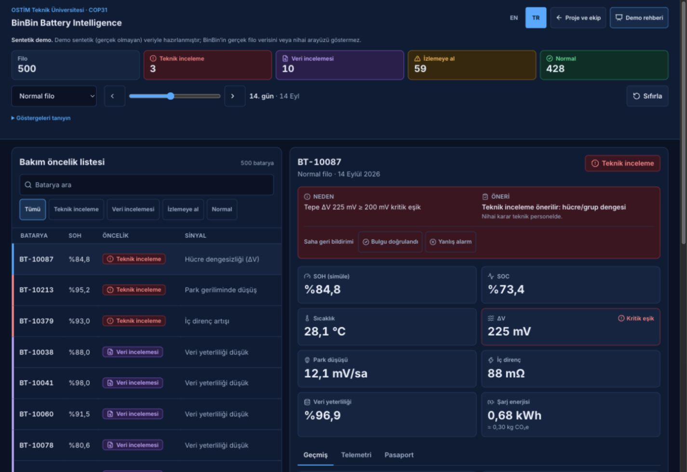

# Demo — önceki mavi palete dönüş

4 Kasım 2026. Kullanıcı yeşil zemin yerine önceki mavi görünümü istedi. `02ea760` sürümündeki tema değerleri geri getirildi: zemin `#0a1224`, panel `#101c34`, kart `#16243f`, çizgi `#263a5e`, metin `#e8eef9`, yardımcı `#a3b3cf`, vurgu `#5aa9ff`. Durumların anlam taşıyan renkleri korunur.

Grafik ızgara/eksen/tooltip çizgileri paletle uyumlandı. Ana sayfa ve demo tanıtımında kalan yeşil sürüm görselleri yerine çalışan mavi demodan iki dilde altı tam ekran ve iki 788×650 ayrıntı tekrar kaydedildi. PNG yakalamalar JPEG olarak sıkıştırıldı; kaynak/alt/sentetik açıklamaları aynı. Görsel bağlantı çubukları da lacivert oldu.

Son üretim derlemesi (`tsc -b && vite build`) ve `git diff --check` geçti. [12 görünüm](kontroller.json): mobil/masaüstü × TR/EN × demo/ana sayfa/demo tanıtımı; yatay taşma yok. [Konsol](tarayici-gunlugu.json) error/warn boş. [Dört metin/zemin kontrastı](kontrast.json) 6,91:1–16,03:1; bu bütün etkileşim durumları için erişilebilirlik sertifikası değildir.

Hesaplar ve etkileşim davranışları değişmedi; önceki kullanılabilirlik düzeltmeleri korundu. Kullanıcıya açık sekme demoda bırakıldı, geçici viewport sıfırlandı. Commit, push veya yayın yapılmadı.

